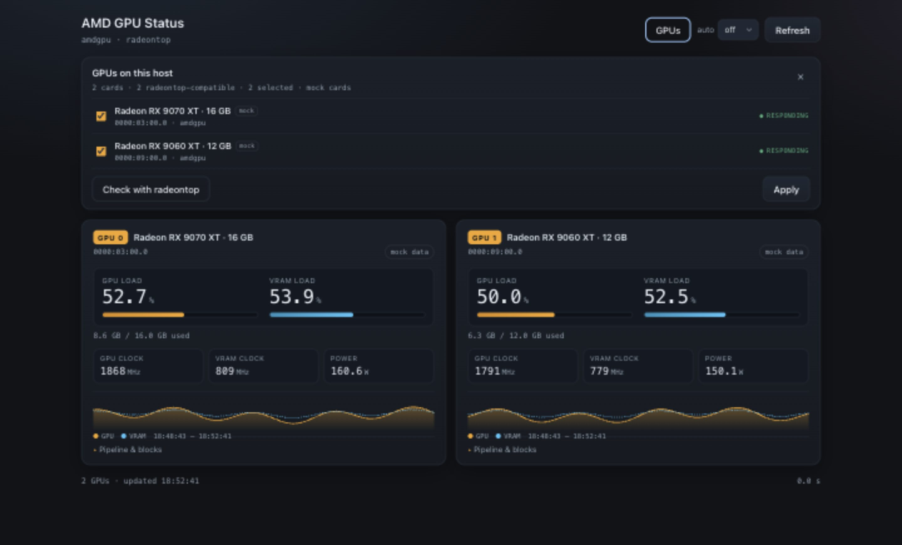

# AMD GPU Status

Live dashboard for the AMD GPUs in a machine, in plain PHP, built to run on
Unraid without Docker. It calls

```php
shell_exec('radeontop -b 3 -d - -l 1');
shell_exec('radeontop -b 9 -d - -l 1');
```

and adds the clock and power values that radeontop does not provide from the
`amdgpu` sysfs interface.

A **GPUs** panel lists every card the kernel exposes, marks the ones radeontop
can use and lets you choose which cards the dashboard samples. Model names come
from `lspci`/`pci.ids`, with a manual override table for new cards.

No Composer, no database, no JavaScript libraries, no CDN.



## What it shows

| Tile | Source | Notes |
|---|---|---|
| Model name + VRAM | `lspci -nn`, `pci.ids`, `lib/cards.php` | in the card header, e.g. `Radeon RX 9070 XT · 16 GB` |
| GPU load | radeontop (`gpu x%`) | falls back to `gpu_busy_percent` |
| VRAM load | radeontop (`vram x%`) | falls back to `mem_busy_percent` |
| VRAM used / total | radeontop + `mem_info_vram_*` | |
| GPU clock | `pp_dpm_sclk` (active level) | hidden when the file is missing |
| VRAM clock | `pp_dpm_mclk` | hidden when the file is missing |
| Power | `hwmon/power1_input`, else `power1_average` | hidden when unavailable |
| Pipeline blocks | radeontop (ee, vgt, ta, …) | collapsed by default |
| History | JSONL file per GPU | drawn as inline SVG |

Missing values are removed from the card instead of showing zeros, so a driver
or GPU that does not expose power simply shows no power tile.

## Requirements

* PHP 8.0+ (CLI or FPM), extensions: none beyond the defaults
* `radeontop` on the machine, runnable as root (it needs `/dev/dri` access)
* an `amdgpu` GPU for the clock/power sysfs values (the utilisation still works
  without them)
* optional: `lspci` (pciutils) or a readable `pci.ids` for model names. Without
  either, cards show `AMD 1002:7550` until you add them to `lib/cards.php`.

Tested against PHP 8.5. On Unraid the webgui ships PHP, so nothing needs to be
installed.

## Install on Unraid (no Docker)

```sh
# 1. copy the folder
mkdir -p /mnt/user/appdata/gpu-status
cp -r ./* /mnt/user/appdata/gpu-status/

# 2. radeontop must exist; Unraid does not ship it.
#    Install it via the NerdTools plugin, or drop a binary in /usr/local/bin.
which radeontop || echo "radeontop still missing"

# 3. try it in the foreground
php -S 0.0.0.0:8087 -t /mnt/user/appdata/gpu-status
```

Then open `http://<tower-ip>:8087/`. Because `/boot/config/go` runs as root,
the built-in server can call radeontop directly – no sudoers entry needed.

Autostart, append to `/boot/config/go`:

```sh
# GPU status dashboard
nohup php -S 0.0.0.0:8087 -t /mnt/user/appdata/gpu-status >/dev/null 2>&1 &
```

Keep the file LF-only: `/boot` is FAT32, CRLF breaks the script.

`radeontop` lives in `/usr/local/bin` on the RAM disk and disappears after a
reboot. If you rely on your own binary, copy it again from the go script, e.g.

```sh
cp /boot/config/radeontop /usr/local/bin/radeontop && chmod +x /usr/local/bin/radeontop
```

### Alternative: Unraid's nginx

If you prefer a path inside the webgui instead of a second port, add a location
block to `/boot/config/nginx/` and point it at the folder. Unraid's php-fpm
runs as root, so radeontop works there as well. If you serve it with a
different user, allow that user to run the binary:

```sh
echo 'www-data ALL=(root) NOPASSWD: /usr/bin/radeontop' > /etc/sudoers.d/radeontop
```

The dashboard tries `sudo -n radeontop …` automatically when the direct call
fails, and otherwise shows the permission error on the card.

## Configuration

`lib/config.php`:

| Key | Default | Meaning |
|---|---|---|
| `buses` | `['3', '9']` | default PCI bus tokens for `radeontop -b`; the GPUs panel stores its own choice in `data/selection.json`. Empty = start with all detected cards |
| `radeontop` | `radeontop` | binary name or absolute path |
| `lspci` | `lspci` | binary used for model names; empty disables it |
| `pci_ids` | `/usr/share/hwdata/pci.ids`, … | files parsed when lspci is missing or has no name |
| `allow_sudo` | `true` | retry with `sudo -n` when the direct call is not permitted |
| `timeout` | `10` | seconds, needs `timeout` from coreutils |
| `history_limit` | `1000` | stored points per GPU |
| `history_points` | `120` | points drawn in the sparkline |
| `data_dir` | `./data` | history, selection and cache location |
| `title` | `AMD GPU Status` | page title |

Model-name overrides live in `lib/cards.php`, keyed by BDF or vendor:device:

```php
return [
    '0000:03:00.0' => 'Radeon RX 9070 XT',
    '1002:7550' => 'Radeon RX 9070 XT',
];
```

## Usage

* **Refresh** button, or press `r`, samples the selected GPUs. One sample takes
  about one second per GPU because radeontop needs a measurement window.
* **auto** dropdown: off, 1, 5, 10, 30 or 60 seconds. The choice is remembered
  in the browser. One sample takes about one second per GPU, so at 1 s a new
  value appears roughly every two seconds.
* **GPUs** opens the card list. Every AMD card below `/sys/class/drm` with the
  `amdgpu` or `radeon` driver is marked radeontop-compatible; other DRM cards
  are listed but disabled with the reason. Tick the cards you want, then
  **Apply**. The selection is stored on the server in `data/selection.json`, so
  every browser and phone sees the same cards.
* **Check with radeontop** runs one measurement per listed card and remembers
  the answer in `data/probe.json`. Each card costs about a second; after that
  the panel shows *responding* or *no answer* without probing again.
* Model names come from `lspci -nn`, then `pci.ids`, then `lib/cards.php`. The
  header shows the name plus the VRAM size read from the driver.
* `?mock=1` shows moving fake data – useful to check the layout without a GPU.
* `debug.php` lists the raw sysfs and radeontop values per bus: which hwmon
  file produced the watt figure, the DPM clock tables and the parsed radeontop
  output. Open it on the target machine when a tile looks wrong.

The watt tile shows board power (GPU, VRAM, memory controller and display
outputs), not the GPU core alone. Both `power1_input` and `power1_average` are
raw microwatt values from the driver. 20–30 W at idle is normal for RDNA2/RDNA3
with a connected display, so compare against `debug.php` rather than against
the idle number you expect.

History is stored in `data/history-<bus>.jsonl`, one JSON object per line, and
is trimmed to `history_limit` entries. `data/last.json` caches the last
response so that double clicks do not start more radeontop processes;
`data/selection.json` and `data/probe.json` hold the GPU panel state. Delete
the folder content if you want to start over.

## Project layout

```
gpu-status/
├── index.php            page shell: cards, GPUs panel, refresh, interval select
├── api.php              JSON endpoint: sample, devices, selection, probe
├── debug.php            diagnostics: raw sysfs/radeontop values, card table
├── lib/
│   ├── config.php       buses, binaries, timeouts, history sizes
│   ├── Sampler.php      one measurement per GPU, merges sources, writes history
│   ├── Devices.php      card discovery, selection, probe cache, model names
│   ├── cards.php        optional model-name overrides
│   ├── Radeontop.php    runs the binary, parses the dump
│   ├── Sysfs.php        card discovery, clocks, power, VRAM, fallbacks
│   ├── Store.php        append-only JSONL history with trimming
│   └── Mock.php         fake data for ?mock=1
├── assets/
│   ├── app.js           fetch, render, sparkline, GPUs panel, interval timer
│   └── style.css        dark theme
├── data/                runtime: history-<bus>.jsonl, selection.json,
│                        probe.json, last.json, .sample.lock
└── docs/
    ├── ARCHITECTURE.md  request flow, parser, sysfs, names, history, locking
    ├── API.md           JSON schema of api.php and diagnostics
    └── screenshot.png
```

## Documentation

* [docs/ARCHITECTURE.md](docs/ARCHITECTURE.md) – how sampling, parsing, sysfs
  reading, card discovery, model names, history and locking work, plus
  extension points.
* [docs/API.md](docs/API.md) – every field of `api.php` including units,
  `null` semantics, the GPU panel actions and the cached/error responses.
* `debug.php` – live view of the raw values on the target machine.

## Troubleshooting

| Card says | Cause |
|---|---|
| `radeontop not found in PATH` | binary missing, or outside the PATH of the PHP process |
| `radeontop needs root: permission denied` | PHP user has no `/dev/dri` access and no sudo rule |
| `no GPU on this bus` | wrong bus token in `lib/config.php` |
| `sysfs fallback` chip | radeontop failed, values come from `gpu_busy_percent` only |
| clocks/power tiles missing | the driver does not expose that file (APU, older kernel) |
| power looks too high | board power includes VRAM and displays; check the raw values in `debug.php` |
| name shows `AMD 1002:7550` | no name in lspci/pci.ids; install pciutils, update pci.ids or add an entry to `lib/cards.php` |
| GPUs panel is empty | no DRM card below `/sys/class/drm`, or the dashboard runs outside the host |

Check the bus IDs with `ls /sys/class/drm/` and
`cat /sys/class/drm/card*/device/uevent | grep PCI_SLOT_NAME`. radeontop expects
the bus in hex, which is why `-b 3` matches `0000:03:00.0`.

## Security

The dashboard has no authentication and binds to `0.0.0.0`. Run it on your LAN
only; if you want it reachable from outside, put it behind the Unraid webgui
login or a reverse proxy with auth.

Bus tokens are validated against the cards the kernel actually exposes before
they reach `radeontop`, and selections are written atomically. There is no
request path that can name a file or a shell argument directly.
